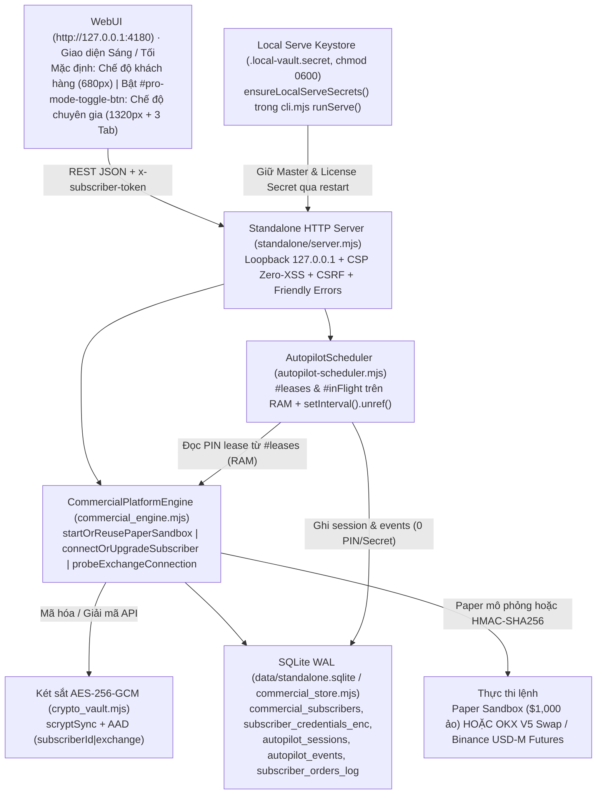

# Hướng Dẫn Toàn Tập TRADING-TOOL (v11.0 -> v13.0): Giao Diện Tối Giản Cho Khách Hàng, Paper Sandbox & Autopilot 24/7

> **Phạm vi tài liệu:** Hướng dẫn đầy đủ lộ trình tiến hóa của hệ thống TRADING-TOOL từ `v1.4` đến `v13.0`, kiến trúc vận hành End-to-End (E2E), hai chế độ giao diện (**Chế độ khách hàng mặc định** và **Chế độ chuyên gia**), hai luồng khởi đầu (Paper Sandbox $1,000 miễn phí và Kết nối tài khoản sàn 4 trường), Buồng lái gọn nhẹ kèm **Giao dịch gần đây**, hộp thoại Cài đặt 2 trường tại chỗ, kiểm tra quyền `Withdraw` thực tế trên OKX/Binance, cô lập đa thuê bao, cơ chế lưu khóa `.local-vault.secret`, và giải đáp các tình huống thực tế khi chạy nền 24/7.
>
> **Nguyên tắc an toàn cốt lõi:** Hệ thống hoạt động 100% theo mô hình **Non-Custodial** (tiền luôn nằm tại tài khoản OKX / Binance của người dùng), chỉ chạy HTTP trên địa chỉ loopback `127.0.0.1` (mặc định `http://127.0.0.1:4180`), luôn giữ mặc định gốc `EXECUTION_MODE=PAPER` và `DRY_RUN=true`, **cấm tuyệt đối** mọi API Key có bật quyền rút tiền (`Withdraw` -> trả lỗi `403`, và khóa an toàn `UNVERIFIED_PERMISSIONS` nếu không xác minh được), và không lưu bất kỳ bí mật thô (`apiSecret`, `passphrase`, `armingPin`, `sessionToken`) vào SQLite.

---

## 1. Tổng Quan Tiến Hóa Dự Án TRADING-TOOL (`v1.4` -> `v13.0`)

Dự án TRADING-TOOL phát triển qua nhiều thế hệ nhằm giải quyết lần lượt 5 bài toán: độ chính xác tín hiệu nhân quả (không nhìn trước tương lai), hiệu suất thực tế sau phí sàn và thanh lý, tự động hóa đa tài sản ngoài TradingView, bảo mật đa thuê bao, và trải nghiệm giao diện tối giản không thuật ngữ cho người dùng phổ thông.

| Phiên bản | Tên cột mốc | Kiến trúc & Bước nhảy kỹ thuật cốt lõi | Cơ chế kiểm soát rủi ro & vận hành |
| :--- | :--- | :--- | :--- |
| **`v1.4`** | SMC Core Engine (Pine v6) | Chỉ báo Pine Script khung `15m` dựa trên cấu trúc CHoCH, Order Block, FVG và RVOL. Khắc phục lỗi duyệt mảng và giới hạn lịch sử `HISTORY_LIMIT = 4500`. | Chỉ vẽ mũi tên tham khảo (~41,1% đến 43,8% sau 10 nến trước phí), chưa có SL/BE+ hay mô phỏng khớp lệnh. |
| **`v2.0`** | Pine Grid Exploration | Bổ sung vòng đời `PAPER IN / OUT`, Heatmap ước tính thanh lý và thử nghiệm 1.680 tổ hợp `MARKET_NEXT_OPEN`. | Thất bại kiểm định OOS (`NOT_ACHIEVED`, 0/840 cấu hình đạt chuẩn 65% WR) do vào lệnh đuổi và quá khớp cục bộ. |
| **`v3.0`** | Pure Pine v6 (`TOOL.pine`) | Chuyển sang cơ chế `LIMIT_PULLBACK`, SL bảo vệ sàn `%`, Confirmed-Close `BE+` và khóa cứng 1x trên `TOOL.pine` & `TOOL_Strategy.pine`. | Đạt **73,53% WR** (`15m`, PF `1,49`) và **74,51% WR** (`1h`, PF `1,40`) trên tập Holdout, DD ~5,6% ở mức 1x. |
| **`v4.0 / v4.1`** | OKX Swap 3Y & VolNorm | Mở rộng dữ liệu OKX Swap 3 năm, chuẩn hóa biến động VolNorm (`2.39x` TB) và mô phỏng funding 0,01%/8h. | Chứng minh BTC `1h` giữ lãi Blind Y3 (+26,45%), nhưng Altcoin (ETH, SOL) thất bại nếu áp nguyên bộ tham số của BTC. |
| **`v5.0`** | Off-TV Standalone + ML | Tách khỏi TradingView bằng Node.js + SQLite WAL (`StandaloneStore`), thêm khớp lệnh Maker `EXCHANGE_POST_ONLY`, funding 8h thực tế và lọc xác suất thắng `ML` (`scikit-learn` khớp Pure-JS sai số `< 1e-12`). | Chỉ cấp phép Live cho luồng đạt cổng kiểm định Holdout Y3 (`BTCUSDT.P`), chặn đặt trùng lệnh qua `StandaloneOrderRouter`. |
| **`v6.0`** | Multi-Asset 5Y & US ETF | Mở rộng dữ liệu 5 năm cho 4 đồng Crypto (`BTCUSDT.P`, `ETHUSDT.P`, `SOLUSDT.P`, `BNBUSDT.P`) tích hợp CVD, cùng dữ liệu 10 năm ETF Mỹ (`SPY`, `DIA`, `QQQ` qua Yahoo Finance v8). | Dẫn đầu giai đoạn Blind Holdout Y5 Crypto Bear (+111,22% Post-Only) với quy tắc kiểm định không rò rỉ dữ liệu. |
| **`v7.0`** | High-WR Frontier & Standalone ML | Thoát lệnh 2 chặng Maker `TP1 + Micro-BE+`, vật lý thanh lý nội nến (`mmr = 0.005`) và phân tách 3 mức rủi ro (`SAFE_75WR`, `BALANCED_75WR`, `TARGET_30MO_75WR`) cùng `Monthly Profit-Sweep`. | Đạt 0 lần thanh lý (`Liq = 0`) xuyên suốt 61 tháng UTC, công khai trung thực rủi ro đuôi của gói đòn bẩy cao ở Y5. |
| **`v8.0`** | Macro-Trend Regime Radar | Bổ sung `research/regime_engine_v8.mjs` đo độ rộng 4 coin so với `1D EMA50`, phân loại 4 chế độ (`BULL_TREND`, `BEAR_TREND`, `BEAR_SQUEEZE`, `RANGE_CHOP`) và tách 16 mô hình Long / Short độc lập. | Chặn Short trong `BEAR_SQUEEZE`, chặn bắt dao rơi trong `BEAR_TREND`, nâng WR danh mục `TIER_3` lên 78,86% (PF `1,74`). |
| **`v9.0`** | 3-Slice Screening & DD Guard | Kiểm duyệt 3 lát cắt Cal/Val (`F1 Bear 2022`, `F2 Recovery 2023`, `F3 Validation`) + Single Cal-Fit ML + bộ giảm đòn bẩy nhân quả `applyCausalDdGuardV9` (giảm về `0.70x` khi Drawdown vượt 15% đến khi hồi về dưới 8%). | Giảm MaxDD của `SAFE_V9` xuống mức thấp nhất (46,89% trên Full 5Y, tháng tệ nhất -19,79%) và đạt `Liq = 0`. |
| **`v10.0`** | Multi-Tenant Vault SaaS | Ra mắt `CommercialPlatformEngine`, `CommercialStore` và `crypto_vault.mjs`: mã hóa API Key đa thuê bao bằng AES-256-GCM + `scryptSync` + AAD (`subscriberId|exchange`), cấp mã `TT10.<payload>.<hmac24>`, tính cỡ lệnh `ctVal` / `stepSize` và 7 chốt chặn. | Tách biệt hoàn toàn dữ liệu và `clOrdId` (`makeTenantClientOrderId`, thuần chữ/số 1 đến 32 ký tự) cho từng người dùng, chặn cứng `Withdraw`. |
| **`v11.0`** | E2E Autopilot Launchpad | Bổ sung `AutopilotScheduler` (`standalone/autopilot-scheduler.mjs`), Quickstart cấp bản quyền cục bộ 1-click (`LOCAL_QUICKSTART_ENABLED=true`), giao diện tiếng Việt và tự phục hồi `REARM_REQUIRED`. | Mã PIN bảo vệ (`armingPin`) chỉ lưu trong `#leases` trên RAM, tự chuyển sang `REARM_REQUIRED` khi server khởi động lại. |
| **`v12.0`** | Human Studio & Paper Sandbox | Bổ sung **$1,000 Paper Sandbox** (`POST /api/autopilot/demo-sandbox`, không cần API Key), chuyển đổi Sáng/Tối, Cockpit có SVG Sparkline, hộp thoại Cài đặt tại chỗ (`<dialog>`), lưu khóa `.local-vault.secret` qua restart, và phản hồi lỗi thân thiện. | Cập nhật hồ sơ tại chỗ theo `subscriberId`, giữ nguyên khóa cũ nếu để trống, bảo toàn mọi bất biến bảo mật. |
| **`v12.5`** | Zero-Jargon Consumer UX | Thiết lập mặc định **Chế độ khách hàng** (khung gọn `680px`, ẩn thanh tab kỹ thuật) kèm nút **`Chế độ chuyên gia`** (`#pro-mode-toggle-btn`), màn hình chào 2 nút, form kết nối 4 trường thiết yếu, Cockpit thuần tiếng Việt (**Giao dịch gần đây**) và gập thông số kỹ thuật vào `#e2e-tech-details`, cùng Cài đặt chỉ 2 ô nhập ngay. | Loại bỏ thuật ngữ thô trên màn hình chính, gập các cấu hình nâng cao và sổ lệnh chi tiết sau `<details>` để người mới không bị choáng ngợp. |
| **`v13.0`** | Permission API & Multi-Tenant Hardening | Truy vấn quyền `Withdraw` thực tế từ sàn (`OKX /api/v5/account/config`, `Binance /fapi/v2/account`) và đóng an toàn mặc định `UNVERIFIED_PERMISSIONS`, khóa bản quyền `TT10` duy nhất cho 1 thuê bao đang hoạt động, cô lập hoàn toàn `subscriberId` / PIN / `delete-profile`, phạm vi `SCAN_SIGNAL_EQUITY` cho US ETF và chuyển tiếp `resetTrips: true`. | Chặn chiếm quyền hồ sơ qua email/tên trùng, chặn tự nâng cấp gói miễn phí, giữ nguyên lệnh entry `SUBMITTED` nếu SL/TP lỗi riêng lẻ và đồng bộ `clOrdId` cho cả SL/TP. |

---

## 2. Sơ Đồ Kiến Trúc Tổng Thể & Luồng E2E Từng Bước

### 2.1. Sơ đồ kiến trúc `v12.5` (Consumer-First UI + Background Autopilot + Local Keystore)



### 2.2. Luồng vận hành End-to-End 5 giai đoạn

#### Bước 1: Khởi động máy chủ cục bộ (`node standalone/cli.mjs serve`)
Trước khi chạy, có thể kiểm tra sức khỏe toàn bộ mô hình `v4.1` đến `v9.0`, `v10CommercialReady`, `v11AutopilotReady`, SQLite WAL và kết nối dữ liệu công khai:
```bash
node standalone/cli.mjs doctor
```
Sau đó khởi động máy chủ cục bộ tại `http://127.0.0.1:4180`:
```bash
node standalone/cli.mjs serve
```
Các thông số an toàn mặc định (`standalone/config.mjs` và `.env.example`):
- Máy chủ chỉ lắng nghe trên loopback `HOST=127.0.0.1` và `PORT=4180`.
- Trạng thái gốc luôn là `EXECUTION_MODE=PAPER` và `DRY_RUN=true`.
- Cờ `LOCAL_QUICKSTART_ENABLED=true` cho phép tự cấp quyền sử dụng cục bộ trên máy cá nhân.
- Chu kỳ quét nền `AUTOPILOT_INTERVAL_SEC=60` (tự động giới hạn trong khoảng `5` đến `3600` giây).
- Bên trong `runServe()`, hàm `ensureLocalServeSecrets(cfg)` tự động nạp hoặc khởi tạo `.local-vault.secret` nếu `.env` chưa cấu hình sẵn khóa (xem chi tiết ở Mục 5).

#### Bước 2: Chọn luồng khởi đầu (Paper Sandbox hoặc Nạp API Key cấm `Withdraw`)
Người dùng bắt đầu từ màn hình chào của **Giao dịch Tự động** (`#e2e-onboarding-hero`):
- **Lựa chọn A (Không cần API Key):** Bấm **"Chạy thử miễn phí với $1,000 ảo"** (`#e2e-paper-sandbox-btn` -> `POST /api/autopilot/demo-sandbox`). Máy chủ tạo hoặc tái sử dụng duy nhất 1 hồ sơ `paper-sandbox@local` ở chế độ `PAPER_AUTO_TRADE` với số dư `$1,000`.
- **Lựa chọn B (Nối sàn OKX / Binance):** Bấm **"Kết nối tài khoản sàn của tôi"** (`#e2e-show-connect-btn`) để mở form kết nối 4 trường (`#e2e-wizard-panel`).
  1. Nếu mở mục **Tùy chọn nâng cao** và bấm **"Kiểm tra kết nối & Xem thử cỡ lệnh"** (`#e2e-verify-btn` -> `POST /api/autopilot/verify-connection`), `probeExchangeConnection` gọi `inspectApiKeyPermissions` sau khi truy vấn API quyền thực tế của sàn (`OKX GET /api/v5/account/config`, `Binance GET /fapi/v2/account`) khi không truyền `rawPermissionPayload` kiểm thử. Nếu phát hiện quyền `withdraw` (OKX) hoặc `enableWithdrawals: true` (Binance), hệ thống lập tức trả lỗi **`403`** kèm thông báo `SECURITY BLOCK` và `userMessage` / `recoveryHint` hướng dẫn tắt quyền rút tiền; nếu không xác minh được quyền (`UNVERIFIED_PERMISSIONS`), Guardrail 2 khóa an toàn mặc định (`GUARDRAIL_2_UNVERIFIED_KEY_PERMISSIONS`) và từ chối chạy auto-trade.
  2. Khi nhấn **"Kết nối & Bắt đầu tự động"** (`#e2e-connect-start-btn` -> `POST /api/autopilot/connect-and-start`), `connectOrUpgradeSubscriber` kiểm tra bản quyền `TT10` duy nhất (mỗi mã `TT10` chỉ gắn cho tối đa 1 thuê bao non-sandbox đang hoạt động qua `findActiveSubscriberByLicenseKey`), mã hóa `apiKey`, `apiSecret`, `passphrase` bằng AES-256-GCM (`encryptCredentials` với `scryptSync` + AAD `subscriberId|exchange`), lưu vào `subscriber_credentials_enc`, còn mã PIN được băm bằng `scryptSync` (`arming_pin_hash`).
  3. **Cô lập hồ sơ đa thuê bao theo `subscriberId`:** Chỉ nâng cấp tại chỗ (`upgradedInPlace: true`) khi khớp đúng `subscriberId` kèm `x-subscriber-token` hợp lệ hoặc đúng `armingPin` (không gộp hồ sơ qua email hay tên trùng). Khi khóa phiên (`Đổi tài khoản`), trình duyệt xóa sạch `subscriberId` khỏi session để kết nối tài khoản mới không đè lên tài khoản cũ.
  4. **Phạm vi cổ phiếu Mỹ (`SCAN_SIGNAL_EQUITY`):** Với gói `INSTITUTIONAL_VIP`, các mã `SPY`, `DIA`, `QQQ` sinh phiếu tín hiệu tham khảo ở trạng thái `SCAN_SIGNAL_EQUITY` và được bỏ qua trước bước gửi lệnh Swap crypto.

#### Bước 3: Phân tầng vốn (`Capital Bracket`) & Tính lô OKX `ctVal` / Binance `stepSize`
Ở bước kiểm tra thử cỡ lệnh hoặc trong mỗi lần quét tài khoản (`scanSubscriberAccount`), hệ thống gọi `classifyCapitalBracket` và `computeExchangeOrderSizing`:

| Tầng vốn (`Capital Bracket`) | Ngưỡng vốn (`equityUsdt`) | Số vị thế đồng thời tối đa | Rủi ro mặc định / lệnh | Quy tắc làm tròn hợp đồng thực tế |
| :--- | :---: | :---: | :---: | :--- |
| **`MICRO`** | `< $150` | `1` | `1.0%` | Giới hạn ký quỹ sử dụng tối đa 85% `availableMarginUsdt`. Nếu vốn nhỏ hơn mức tối thiểu của sàn (ví dụ Binance `BTCUSDT` có `minNotionalUsdt = 100`), lệnh được đánh dấu `feasible: false` (`BELOW_BINANCE_MIN_NOTIONAL`) để ưu tiên cặp lô nhỏ như `SOLUSDT` hoặc OKX `BTC-USDT-SWAP` (`ctVal = 0.01`, `minSz = 0.01`). |
| **`STANDARD`** | `$150` đến `$2,000` | `3` | `1.0%` | Chia lô chính xác theo `OKX_SWAP_DEFAULT_SPECS` (`ctVal`, `lotSz`, `minSz`, `tickSz`) hoặc `BINANCE_USDM_DEFAULT_SPECS` (`stepSize`, `minQty`, `minNotionalUsdt`, `tickSize`) bằng `roundToStep(..., 'floor')`. |
| **`PRO_WHALE`** | `> $2,000` | `4` | `1.25%` | Tự động chặn trần theo `equity * maxLeverageCap`, `availMargin * 0.85 * maxLeverageCap`, `maxOrderUsdt` và trần vốn `maxCapitalUsdt` của gói bản quyền. |

#### Bước 4: Bật `AutopilotScheduler` chạy nền 24/7
Khi người dùng bấm **"Chạy thử miễn phí với $1,000 ảo"** hoặc **"Kết nối & Bắt đầu tự động"**:
1. `AutopilotScheduler.armSubscriber(...)` xác thực `armingPin` (hoặc cho phép zero-PIN riêng với hồ sơ Paper Sandbox chưa đặt PIN), nạp lease tạm thời vào Map riêng tư `#leases` trên RAM, đặt trạng thái `ARMED_RUNNING` trong `autopilot_sessions` và ghi sự kiện `ARMED` vào `autopilot_events`.
2. Vòng lặp nền `AutopilotScheduler.start()` (`setInterval(...).unref()`) tự động quét các phiên đến hạn (`now >= next_tick_at`) với khóa chống chạy chồng `#inFlight`:
   - Đồng bộ dữ liệu nến mới nhất không gây gián đoạn qua `daemon.syncMarketData`.
   - Chạy `commercialEngine.runSubscriberAutoTradeCycle`: chấm điểm Radar v8 + ML v9, cập nhật số dư và sinh `subscriber_signal_tickets`.
   - Tạo mã lệnh đa thuê bao `makeTenantClientOrderId` (thuần chữ/số 1 đến 32 ký tự `^[A-Za-z0-9]{1,32}$`). Nếu mã lệnh đã `SUBMITTED` hoặc `SUBMITTING`, ghi nhận `IDEMPOTENT_SKIP` để không bao giờ vào trùng lệnh trên cùng một cây nến.
   - Hủy các lệnh entry `post_only` / `LIMIT_GTX` cũ đã quá hạn tín hiệu, gửi lệnh entry `post_only` mới (hoặc lệnh mô phỏng trong `_buildPaperSandboxClient` nếu ở chế độ Paper Sandbox), và gắn ngay cặp lệnh bảo vệ `oco_reduce_only` / `SL_TP_REDUCE_ONLY` (`reduceOnly: true`).

#### Bước 5: 7 Chốt chặn an toàn (`G1..G7`) & Khôi phục sau restart
Hàm `buildGuardrailChecklist` kiểm định liên tục 7 chốt chặn trước mỗi chu kỳ giao dịch:

| Mã | Tên chốt chặn | Cơ chế kiểm tra & hành vi khi vi phạm |
| :--- | :--- | :--- |
| **`G1`** | Bản quyền `TT10` & Chế độ chạy | Kiểm tra chữ ký HMAC-SHA256, thời hạn `expiresAtMs`, khóa đơn nhất `findActiveSubscriberByLicenseKey` (cấm dùng chung 1 mã `TT10` cho nhiều thuê bao) và `isCommercialModeAllowed` (`PAPER_AUTO_TRADE` chỉ mở cho Paper Sandbox, `STARTER_SCAN_SIGNAL` chỉ cho phép `SCAN_AND_SIGNAL_ONLY`). |
| **`G2`** | Chặn `Withdraw` & `UNVERIFIED_PERMISSIONS` | Truy vấn quyền thực từ OKX `/api/v5/account/config` và Binance `/fapi/v2/account`, kiểm tra `subscriber_credentials_enc.has_withdraw_perm` và `permission_summary`. Trả `403` nếu có quyền rút tiền, hoặc khóa an toàn mặc định `GUARDRAIL_2_UNVERIFIED_KEY_PERMISSIONS` nếu chưa xác minh được quyền (`UNVERIFIED_PERMISSIONS`). |
| **`G3`** | Mã PIN & RAM Lease (`#leases`) | Xác thực `armingPin` (hoặc zero-PIN cho Paper Sandbox) và xác nhận lease đang tồn tại trong RAM. |
| **`G4`** | Cầu chì lỗ ngày (`Daily Loss CB`) | Nếu lỗ trong ngày UTC đạt ngưỡng `max_daily_loss_pct` (mặc định `5%`), ngắt ngay chu kỳ đặt lệnh (`GUARDRAIL_4_CIRCUIT_BREAKER_TRIPPED`). |
| **`G5`** | Công tắc khẩn cấp MaxDD (`Kill Switch`) | Theo dõi đỉnh vốn `high_water_equity_usdt`. Nếu sụt giảm đạt `max_dd_kill_pct` (mặc định `20%`), ngắt vĩnh viễn (`GUARDRAIL_5_KILL_SWITCH_TRIPPED`) cho đến khi chủ tài khoản tự reset (`resetTrips: true`). |
| **`G6`** | Trần vốn gói & Trần đòn bẩy | Từ chối mở vị thế nếu `total_equity_usdt > plan.maxCapitalUsdt` hoặc `max_leverage_cap > 3.0`. |
| **`G7`** | Khớp lô sàn & Mã `clOrdId` chống trùng | Chỉ định tuyến lệnh có `feasible === true`, đảm bảo định dạng `^[A-Za-z0-9]{1,32}$` và chống đặt đúp theo từng nến. |

- **Tự ngắt khi chạm chốt chặn `G1..G5`:** `tickSubscriber` xóa lease khỏi RAM, chuyển phiên sang `TRIPPED` và ghi sự kiện `GUARDRAIL_TRIP`.
- **Khôi phục khi máy chủ khởi động lại:** `CommercialPlatformEngine` chuyển các lệnh `SUBMITTING` sang `INTERRUPTED` (`recoverInterruptedSubscriberOrders()`), còn `AutopilotScheduler` chuyển các phiên `ARMED_RUNNING` sang `REARM_REQUIRED` với lý do `SERVER_RESTART_PIN_REARM_REQUIRED` (`recoverInterruptedAutopilotSessions()`).

---

## 3. Chế Độ Khách Hàng Mặc Định vs Chế Độ Chuyên Gia & Hai Luồng Khởi Đầu

### 3.1. Chế độ khách hàng (mặc định) vs Chế độ chuyên gia (`#pro-mode-toggle-btn`)
Khi mở `http://127.0.0.1:4180`, hệ thống mặc định chạy ở **Chế độ khách hàng** (`state.proMode = false`, lưu trong `localStorage` dưới khóa `'tt12_pro_mode'`):
- **Chế độ khách hàng (mặc định):**
  - Giao diện thu gọn vào cột trung tâm rộng tối đa `680px` (`body:not(.pro-mode) .dashboard`), tiêu đề **"Giao dịch Tự động"**, dòng phụ *"Tự động giao dịch an toàn · Không bao giờ có quyền rút tiền"*.
  - Thanh tab điều hướng (`#workspace-tabs-nav`) và dải trạng thái kỹ thuật (`#e2e-status-banner`, trừ khi bị ngắt `TRIPPED`) được ẩn để tránh gây rối mắt.
  - Chỉ báo trạng thái trên thanh tiêu đề dùng ngôn ngữ tự nhiên ngắn gọn (`Chưa bật` / `Đang chạy` / `Tạm dừng` / `Cần mở khóa`), nút dừng khẩn cấp hiển thị là **`Dừng ngay`**.
- **Chế độ chuyên gia (`Chế độ chuyên gia` - `#pro-mode-toggle-btn`):**
  - Khi bấm nút **`Chế độ chuyên gia`** ở góc phải thanh tiêu đề (`body.pro-mode .dashboard` mở rộng tới `1320px`), thanh 3 tab hiện ra ngay lập tức:
    1. **Tự động Trade** (`#view-tab-autopilot`): tự động mở rộng phần thông số kỹ thuật (`#e2e-tech-details`) và hiển thị thêm dải trạng thái (`#e2e-status-banner`).
    2. **Sơ đồ Luồng** (`#view-tab-flow`): sơ đồ 6 giai đoạn tương tác kèm bảng tiến hóa `v1.4` đến `v12.5`.
    3. **Quant Pro Terminal** (`#view-tab-quant`): biểu đồ nến, Macro-Trend Regime Radar v8, Live ML Probability Gauge, Monthly Profit-Sweep Gauge, Order Router Log, Ma trận 10 Thế Hệ và khu vực Commercial SaaS Hub.
  - Nếu bạn tắt `Chế độ chuyên gia` khi đang xem tab `Sơ đồ Luồng` hoặc `Quant Pro Terminal`, hệ thống tự động quay về màn hình chính **Tự động Trade**.

### 3.2. Màn hình Chào 2 nút & Luồng 1: `$1,000 Paper Sandbox` (Không cần API Key)
Ở trạng thái Onboarding (chưa kết nối), màn hình chào (`#e2e-onboarding-hero`) có tiêu đề **"Bắt đầu giao dịch tự động"**, câu mô tả ngắn *"Hệ thống tự theo dõi thị trường 24/7 và đặt lệnh kèm mức chốt lời, cắt lỗ bảo vệ sẵn cho bạn."* và đúng **2 nút hành động**:
1. **`Chạy thử miễn phí với $1,000 ảo`** (`#e2e-paper-sandbox-btn`):
   - Bấm 1 lần để gọi `POST /api/autopilot/demo-sandbox`.
   - Không cần nhập API Key, không cần đặt PIN. Hệ thống tạo hoặc tái sử dụng hồ sơ `paper-sandbox@local`, cấp `$1,000` tiền ảo, bật `AutopilotScheduler` ở chế độ `PAPER_AUTO_TRADE` và chuyển thẳng sang Buồng lái theo dõi tài sản.
2. **`Kết nối tài khoản sàn của tôi`** (`#e2e-show-connect-btn`):
   - Mở biểu mẫu kết nối sàn (`#e2e-wizard-panel`) ở Luồng 2 dưới đây. Khi đang ở biểu mẫu kết nối, có thể bấm **`Quay lại`** (`#e2e-hide-connect-btn`) để quay lại màn hình chào 2 nút.

### 3.3. Luồng 2A: Kết nối tài khoản sàn 4 trường thiết yếu (Quickstart cục bộ)
Dành cho người dùng cá nhân tự chạy bot bằng API sàn OKX hoặc Binance (`LOCAL_QUICKSTART_ENABLED=true`):
1. Bấm **`Kết nối tài khoản sàn của tôi`** (`#e2e-show-connect-btn`) để mở `#e2e-wizard-panel`.
2. Giao diện chỉ hiển thị trực tiếp **4 trường thiết yếu**:
   - **Sàn giao dịch** (`#e2e-ex-select`): `OKX` hoặc `Binance`.
   - **Tạo mã PIN bảo vệ (từ 4 ký tự)** (`#e2e-pin-input`, kèm nút **Hiện / Ẩn** `.eye-toggle-btn`).
   - **API Key** (`#e2e-apikey-input`, kèm nút **Hiện / Ẩn**).
   - **Mã bí mật (API Secret)** (`#e2e-apisecret-input`, kèm nút **Hiện / Ẩn**), và tự động hiện thêm **Mật khẩu API OKX** (`#e2e-passphrase-wrap` / `#e2e-passphrase-input`) khi chọn OKX (tự ẩn khi chọn Binance).
3. **Các tùy chọn nâng cao đã được gập gọn (`<details id="e2e-wizard-advanced-details">`):**
   - Nhãn tóm tắt: **`Tùy chọn nâng cao (mặc định: Thử nghiệm an toàn)`**.
   - Nếu không mở mục này, hệ thống mặc định chạy trên **Thử nghiệm trên sàn (Demo / Testnet)**, tên tài khoản **`Tài khoản của tôi`**, chiến lược **`Ưu tiên an toàn`** (`SAFE_75WR|v9`), cắt lỗ ngày `5%`, dừng khẩn cấp MaxDD `20%`, chu kỳ `60s`, và tự động cấp quyền sử dụng cục bộ (`#e2e-local-quickstart` được tích sẵn).
   - Nếu mở `#e2e-wizard-advanced-details`, bạn có thể chuyển sang `Giao dịch tiền thật (Live)`, đặt vốn thử nghiệm, điều chỉnh tỷ lệ rủi ro, hoặc bấm **`Kiểm tra kết nối & Xem thử cỡ lệnh`** (`#e2e-verify-btn` -> `POST /api/autopilot/verify-connection`).
4. Bấm **`Kết nối & Bắt đầu tự động`** (`#e2e-connect-start-btn` -> `POST /api/autopilot/connect-and-start`). Mọi khóa thô trong ô nhập liệu trên trình duyệt được xóa sạch ngay sau khi gửi.

### 3.4. Luồng 2B: Khách hàng thương mại (Nhập mã bản quyền `TT10`)
Dành cho mô hình Seller / Operator vận hành máy chủ chiến lược và cấp mã bản quyền `TT10.<payload>.<hmac24>` cho Buyer:
1. **Phía Seller / Operator:**
   - Cấu hình `COMMERCIAL_MASTER_KEY` (>= 32 ký tự), `COMMERCIAL_LICENSE_SECRET` và `COMMERCIAL_ADMIN_TOKEN` trong `.env`. Nếu không muốn cho phép tự cấp license cục bộ trên máy chủ thương mại, đặt `LOCAL_QUICKSTART_ENABLED=false`.
   - Cấp mã `TT10` cho khách hàng bằng CLI hoặc `POST /api/commercial/admin/licenses`:
     ```bash
     node standalone/cli.mjs license --plan PRO_AUTO_TRADER --days 30 --ref buyer@example.com
     ```
   - 3 gói thương mại (`COMMERCIAL_PLANS` trong `standalone/license_issuer.mjs`):

   | Mã gói (`planId`) | Giá tham khảo | Chế độ được phép (`allowedModes`) | Trần vốn (`maxCapitalUsdt`) | Vị thế tối đa | Tài sản được quét (`allowedSymbols`) |
   | :--- | :---: | :--- | :---: | :---: | :--- |
   | `STARTER_SCAN_SIGNAL` | `$29 / tháng` | Chỉ `SCAN_AND_SIGNAL_ONLY` | `$5,000` | `2` | `BTCUSDT.P`, `SOLUSDT.P`, `BNBUSDT.P` |
   | `PRO_AUTO_TRADER` | `$79 / tháng` | `SCAN_AND_SIGNAL_ONLY`, `DEMO_AUTO_TRADE`, `LIVE_AUTO_TRADE` | `$25,000` | `4` | `BTCUSDT.P`, `ETHUSDT.P`, `SOLUSDT.P`, `BNBUSDT.P` |
   | `INSTITUTIONAL_VIP` | `$199 / tháng` | `SCAN_AND_SIGNAL_ONLY`, `DEMO_AUTO_TRADE`, `LIVE_AUTO_TRADE` | `$250,000` | `8` | 4 Crypto + `SPY`, `DIA`, `QQQ` |

2. **Phía Buyer:**
   - Khi mở `#e2e-wizard-panel`, mở mục **`Tùy chọn nâng cao (mặc định: Thử nghiệm an toàn)`** (`#e2e-wizard-advanced-details`), bỏ chọn ô **`Tự động cấp quyền sử dụng trên máy này`** (`#e2e-local-quickstart`) để hiện ô **`Mã bản quyền (nếu có)`** (`#e2e-license-input`). (Nếu server đặt `LOCAL_QUICKSTART_ENABLED=false`, ô này tự động hiện ra).
   - Dán mã `TT10...`, điền 4 trường API + PIN và bấm **`Kết nối & Bắt đầu tự động`**. Lưu ý gói `STARTER_SCAN_SIGNAL` chỉ cho phép quét tín hiệu (`SCAN_AND_SIGNAL_ONLY`), không cho phép bật auto-trade.

---

## 4. Giao Diện Sáng / Tối, Buồng Lái Gọn Nhẹ & Hộp Thoại Cài Đặt Tại Chỗ

### 4.1. Chuyển đổi Giao diện Sáng / Tối (`Light / Dark Theme`)
- Ở góc phải thanh tiêu đề có nút **`Giao diện: Sáng`** / **`Giao diện: Tối`** (`#theme-toggle-btn`).
- Giao diện hỗ trợ song song bảng màu Sáng (nền giấy ấm `#f4f5f2` và chữ xanh mực `#182923`) và bảng màu Tối (`#0b1014`), đồng bộ trực tiếp với `<meta name="color-scheme" content="light dark">` và quy tắc CSS `:root { color-scheme: light dark; }`.
- Lựa chọn được lưu vào `localStorage` (`tt12_theme`); nếu chưa từng chọn thủ công, hệ thống tự động theo cài đặt Sáng/Tối của hệ điều hành.

### 4.2. Buồng lái tài khoản (`#e2e-cockpit-panel`): Gọn nhẹ cho khách hàng, Đầy đủ cho chuyên gia
Khi đã mở khóa hoặc đang chạy Autopilot, Buồng lái hiển thị 3 phần rõ ràng:
1. **Thẻ tài sản tĩnh tại (`#e2e-portfolio-hero`):**
   - Hiển thị trạng thái trực tiếp (`#e2e-cockpit-live-badge`: `Đang tự động giao dịch` / `Đã tạm dừng`...) và nhãn tài khoản dễ hiểu (`#e2e-cockpit-account-label`).
   - Hiển thị **Tổng tài sản** (`#e2e-kpi-equity`), lãi/lỗ hôm nay (`#e2e-hero-pnl`) và **Biến động tài sản** dạng SVG sparkline (`#e2e-equity-sparkline` vẽ từ `portfolioSummary.equitySparkline` / `scanHistory`).
   - Chỉ giữ **2 chỉ số thuần tiếng Việt** trên thẻ chính (không có enum kỹ thuật thô):
     - **Chế độ** (`#e2e-hero-mode`): `Dùng thử tiền ảo ($1,000)` / `Tài khoản thử nghiệm (Demo)` / `Giao dịch tiền thật`.
     - **Bảo vệ vốn** (`#e2e-kpi-safety` & `#e2e-kpi-safety-sub`): `Đang bật an toàn` kèm mức `Tự nghỉ hôm nay nếu lỗ tới 5%` (hoặc cảnh báo nếu chốt chặn bị ngắt).
   - 4 nút thao tác rõ ràng: **`Tạm dừng`** (`#e2e-pause-btn`), **`Tiếp tục chạy tự động`** (`#e2e-resume-btn`), **`Cài đặt`** (`#e2e-open-settings-btn`), và **`Đổi tài khoản`** (`#e2e-switch-account-btn` để khóa phiên hiện tại và quay lại chọn hồ sơ khác).
2. **Thẻ `Giao dịch gần đây` (`#e2e-simple-activity-card` / `#e2e-simple-activity-list`):**
   - Dịch tự động các vị thế đang mở và lệnh đặt sang câu tiếng Việt dễ hiểu (ví dụ: `Mua BTC · Khối lượng 0.03 · Đã đặt sẵn chốt lời & cắt lỗ`, kèm nhãn trạng thái `Đang chờ khớp`, `Đang giữ lệnh`, `Đã hủy`, hoặc `Không khớp`), đồng thời tự ẩn các dòng kỹ thuật ghép cặp `oco_reduce_only` để tránh rối.
   - Khi chưa có lệnh nào, thẻ hiển thị nhẹ nhàng: *"Hệ thống đang theo dõi thị trường (BTC, ETH, SOL, BNB) và chỉ vào lệnh khi có tín hiệu thật sự an toàn."*
3. **Khối thông số kỹ thuật gập gọn (`<details id="e2e-tech-details">`):**
   - Mặc định **đóng gọn** ở Chế độ khách hàng (`Xem thông số kỹ thuật & sổ lệnh chi tiết` với nhãn `Dành cho chuyên gia`).
   - Tự động mở khi bạn bật **Chế độ chuyên gia** (`#pro-mode-toggle-btn`) hoặc khi có bất kỳ chốt chặn an toàn nào gặp sự cố.
   - Bên trong chứa: nút **`Quét thị trường ngay`** (`#e2e-scan-now-btn`), phân tầng vốn (`#e2e-kpi-bracket`), nhịp quét tiếp theo (`#e2e-kpi-heartbeat`), xu hướng thị trường (`#e2e-kpi-regime`), mục chốt chặn ưu tiên ngoại lệ (`<details id="e2e-guardrails-details">`), Vị thế đang mở (`#e2e-positions-table`), Phiếu Tín Hiệu Cá Nhân Hóa (`#e2e-tickets-table`), Sổ Lệnh Tự Động (`#e2e-orders-table`), và Nhật ký sự kiện (`#e2e-events-list`). Trên màn hình di động (`390px`), các bảng tự động xếp thành danh sách dọc kèm nhãn cột (`@container` stacked layout).

### 4.3. Hộp thoại Cài đặt đơn giản hóa (`<dialog id="e2e-settings-dialog">`) & Xóa hồ sơ
Bấm **`Cài đặt`** (`#e2e-open-settings-btn`) trong Buồng lái để mở hộp thoại `<dialog id="e2e-settings-dialog">` (dùng native `showModal()`):
- **Chỉ 2 trường hiện sẵn ngay lập tức:**
  1. **Tên gợi nhớ** (`#e2e-set-name`)
  2. **Tự nghỉ trong ngày nếu lỗ tới (%)** (`#e2e-set-daily-loss`)
- **2 mục gập gọn dạng hairline bên dưới:**
  - **`Đổi khóa API sàn giao dịch`** (`<details id="e2e-settings-keys-details">`): cho phép đổi Sàn (`OKX` / `Binance`), Môi trường (`Thử nghiệm (Demo / Paper)` / `Tiền thật (Live)`), `API Key mới`, `Mã bí mật mới`, `Mật khẩu API OKX mới`, và `Mã PIN xác nhận`. **Nếu để trống ô khóa mới, hệ thống giữ nguyên hoàn toàn khóa đã mã hóa AES-256-GCM hiện tại.**
  - **`Tùy chỉnh nâng cao`** (`<details id="e2e-settings-adv-details">`): Email, Chiến lược (`Ưu tiên an toàn` / `Cân bằng` / `Tăng trưởng`), Dừng khẩn cấp nếu hụt vốn (%), và Chu kỳ quét (giây).
- **Cập nhật tại chỗ (`POST /api/autopilot/settings`):** Bấm **`Lưu thay đổi`** để cập nhật trực tiếp hồ sơ hiện tại (và cập nhật chu kỳ cho `AutopilotScheduler` qua `updateLeaseSchedule`) mà không tạo bản sao trùng lặp.
- **Xóa hồ sơ có xác thực (`POST /api/autopilot/delete-profile`):**
  - Trong hộp thoại Cài đặt có cơ chế xác nhận 2 bước: bấm **`Xóa hồ sơ này`** (`#e2e-delete-profile-btn`) -> bấm **`Xác nhận xóa vĩnh viễn`** (`#e2e-delete-confirm-btn`).
  - Hoặc tại màn hình mở khóa **`Chào mừng quay lại`** (`#e2e-saved-profiles-card`), nhập PIN bảo vệ (nếu là hồ sơ có PIN) rồi bấm **`Xóa hồ sơ`** (`#e2e-quick-delete-profile-btn`).
  - Máy chủ bắt buộc xác thực bằng `x-subscriber-token` khớp `subscriberId`, `x-admin-token`, đúng `armingPin`, hoặc hồ sơ Paper Sandbox chưa đặt PIN khi `LOCAL_QUICKSTART_ENABLED=true`, sau đó ngừng Autopilot (`disarmSubscriber`), xóa lease RAM và gọi `deleteSubscriberCascade` xóa sạch dữ liệu liên quan khỏi SQLite.
- **Đặt lại cầu chì sau khi ngắt (`resetTrips: true`):** Khi cầu chì ngày `G4` hoặc MaxDD `G5` bị ngắt, có thể chủ động khôi phục thông qua `POST /api/commercial/subscribers/mode` kèm `resetTrips: true` và mã PIN hợp lệ.

---

## 5. Lưu Khóa Cục Bộ (`.local-vault.secret`), Bảo Mật & Tình Huống Thực Tế

### 5.1. Cơ chế lưu khóa `.local-vault.secret` qua các lần khởi động lại server
- Khi chạy `node standalone/cli.mjs serve`, hàm `ensureLocalServeSecrets(cfg)` kiểm tra xem biến môi trường hoặc file `.env` đã có `COMMERCIAL_MASTER_KEY` và `COMMERCIAL_LICENSE_SECRET` hay chưa:
  - Nếu chưa có, máy chủ tự tạo và lưu 2 khóa ngẫu nhiên 256-bit vào file **`.local-vault.secret`** tại thư mục gốc dự án với quyền bảo mật **`chmod 0600`** (chỉ chủ sở hữu máy đọc/ghi được).
  - File `.local-vault.secret` và `.local-vault.secret.*` đã được đưa vào **`.gitignore`** để không bao giờ bị đẩy nhầm lên Git.
  - Nhờ `.local-vault.secret`, khi tắt máy hoặc khởi động lại `node standalone/cli.mjs serve`, khóa giải mã AES-256-GCM và khóa xác thực chữ ký `TT10` vẫn giữ nguyên, nên **tất cả hồ sơ đã lưu và khóa API đã mã hóa trong `data/standalone.sqlite` vẫn mở khóa và dùng tiếp được bình thường**.
- **Lưu ý bất biến cấu hình:** Hàm `loadConfig()` thuần túy không tự đọc `.local-vault.secret`, nên khi chưa đặt biến trong `.env`, `redactConfig().commercial.masterKeyConfigured` vẫn trả về `false` đúng theo tiêu chuẩn kiểm định an toàn.

### 5.2. Giải đáp các tình huống thực tế

#### Tình huống 1: Khác biệt giữa Paper Sandbox, Demo/Testnet và Live
- **`PAPER_AUTO_TRADE` (Dùng thử tiền ảo $1,000):** Chạy 100% mô phỏng cục bộ qua `_buildPaperSandboxClient`, không cần API Key, không cần PIN, không gửi lệnh thật lên sàn.
- **`DEMO_AUTO_TRADE` (Tài khoản thử nghiệm Demo / Testnet):** Kết nối tới môi trường Demo của sàn (OKX gắn header `x-simulated-trading: 1`), kiểm tra định cỡ `ctVal` / `stepSize` thật mà không đụng tiền thật. Khuyến nghị chạy tối thiểu 14 ngày trước khi chuyển sang tiền thật.
- **`LIVE_AUTO_TRADE` (Giao dịch tiền thật):** Bắt buộc API Key chỉ có `Read + Trade` (chặn cứng `Withdraw`), khuyến nghị gắn IP Whitelist trên sàn, và đòi hỏi `COMMERCIAL_MASTER_KEY` dài tối thiểu 32 ký tự (được đáp ứng tự động bởi `.env` hoặc `.local-vault.secret` khi chạy `serve`).

#### Tình huống 2: Màn hình "Chào mừng quay lại" sau khi F5, đóng tab hoặc bấm "Đổi tài khoản" / "Khóa phiên"
- Trình duyệt chỉ lưu `tt11_session_token` và `tt11_subscriber_id` trong `window.sessionStorage`, tuyệt đối không lưu API Secret hay mã PIN trên trình duyệt.
- Khi đóng tab hoặc bấm **`Đổi tài khoản`** (`#e2e-switch-account-btn`) / **`Khóa phiên`** (`#e2e-lock-session-btn`), giao diện xóa token khỏi `sessionStorage` và hiện thẻ **`Chào mừng quay lại`** (`#e2e-saved-profiles-card`) với danh sách tài khoản bằng tiếng Việt dễ hiểu (ví dụ: `Paper Sandbox ($1,000) · OKX (Tiền ảo)` hoặc `Tài khoản của tôi · OKX (Thử nghiệm)`):
  - Với hồ sơ sàn có đặt PIN: nhập lại **Mã PIN bảo vệ** và bấm **`Mở khóa & Tiếp tục`** (`POST /api/commercial/subscribers/unlock` xoay vòng token mới, không cần nhập lại API Key/Secret).
  - Với hồ sơ **Paper Sandbox $1,000** chưa đặt PIN: ô nhập mã PIN (`#e2e-unlock-pin-row`) tự động ẩn đi, chỉ cần bấm 1 lần **`Mở khóa & Tiếp tục`** là vào lại ngay.

#### Tình huống 3: Máy tắt, mất điện hoặc khởi động lại server (`REARM_REQUIRED`)
- Vì mã PIN chỉ nằm trong `#leases` trên RAM, khi tiến trình máy chủ bị tắt hoặc khởi động lại:
  1. `CommercialPlatformEngine` chuyển các lệnh đang `SUBMITTING` sang `INTERRUPTED`.
  2. `AutopilotScheduler` gọi `recoverInterruptedAutopilotSessions()`, chuyển mọi phiên `ARMED_RUNNING` thành **`REARM_REQUIRED`** với lý do **`SERVER_RESTART_PIN_REARM_REQUIRED`** và ghi sự kiện `REARM_REQUIRED` vào `autopilot_events`.
  3. Hệ thống **không tự ý đặt lệnh** khi chưa có chủ tài khoản xác nhận lại.
- **Cách khôi phục:** Mở lại `http://127.0.0.1:4180`, chọn tài khoản ở thẻ **`Chào mừng quay lại`**, nhập lại mã PIN (giữ tích **"Tự động tiếp tục chạy 24/7 sau khi mở khóa"**) và bấm **`Mở khóa & Tiếp tục`**.

#### Tình huống 4: Nút "Dừng ngay" hoặc "Tạm dừng" có hủy lệnh cắt lỗ/chốt lời bảo vệ không?
- **KHÔNG.** Khi bấm **`Dừng ngay`** (`#topbar-emergency-stop-btn` / `#e2e-emergency-stop-btn`) hoặc **`Tạm dừng`** (`#e2e-pause-btn`), trình duyệt gọi `POST /api/autopilot/stop` với `cancelPendingEntries: true`:
  - `AutopilotScheduler.disarmSubscriber` xóa lease trên RAM và chỉ hủy các lệnh chờ vào mới (`post_only` / `LIMIT_GTX` có `reduceOnly === false` ở trạng thái `SUBMITTED`).
  - Toàn bộ lệnh dừng lỗ và chốt lời bảo vệ vị thế đang mở (`oco_reduce_only` / `SL_TP_REDUCE_ONLY` với `reduceOnly === true`) được **giữ nguyên hoàn toàn** trên sàn.

#### Tình huống 5: Nhận thông báo lỗi thân thiện khi thao tác sai
- Mọi phản hồi lỗi từ API đều giữ cấu trúc chuẩn `{ ok: false, error, userMessage, recoveryHint }` do `buildFriendlyErrorPayload` tạo ra. Giao diện tự động hiển thị câu giải thích tiếng Việt rõ ràng kèm **Gợi ý** khắc phục (ví dụ khi API Key còn quyền Withdraw, sai mã PIN, hết hạn phiên, hoặc thiếu Mật khẩu API OKX) thay vì chỉ hiện mã lỗi kỹ thuật.

---

## 6. Danh Mục Endpoint & Lệnh CLI Tham Chiếu Nhanh

### 6.1. Lệnh CLI (`standalone/cli.mjs`)
- `node standalone/cli.mjs doctor`: Kiểm tra Node >= 22, SQLite WAL, mô hình `v4.1` đến `v9.0`, `v10CommercialReady`, `v11AutopilotReady` và kết nối public.
- `node standalone/cli.mjs serve`: Khởi động WebUI, nạp/tạo `.local-vault.secret` qua `ensureLocalServeSecrets()`, và chạy `AutopilotScheduler` tại `http://127.0.0.1:4180` (hỗ trợ `--port <số cổng>`).
- `node standalone/cli.mjs license --plan PRO_AUTO_TRADER --days 30 --ref buyer@example.com`: Cấp mã `TT10` cho khách hàng thương mại.
- `node standalone/cli.mjs commercial-sim --equity 1500 --exchange OKX --version v9 --tier SAFE_75WR`: Mô phỏng nhanh phân tầng vốn và quy đổi lô hợp đồng trên dòng lệnh.

### 6.2. REST API v11.0 & v12.5 (`standalone/server.mjs`)
- `GET /api/status`: Trạng thái tổng thể daemon, các mô hình (`v11AutopilotReady: true`, `v10CommercialReady: true`) và config đã lọc bí mật.
- `GET /api/autopilot/status`: Trạng thái Autopilot, `savedProfiles`, `portfolioSummary` (gồm `equitySparkline`), `scanHistory`, `activePositions`, `guardrailChecklist`, `events`, `tickets`, `orders`.
- `POST /api/autopilot/demo-sandbox`: Khởi tạo hoặc tái sử dụng tài khoản `$1,000 Paper Sandbox` không cần API Key, cấp `sessionToken` và bật `AutopilotScheduler` ở chế độ `PAPER_AUTO_TRADE`.
- `POST /api/autopilot/quickstart-license`: Cấp mã `TT10` cục bộ khi `LOCAL_QUICKSTART_ENABLED=true`.
- `POST /api/autopilot/verify-connection`: Kiểm tra quyền API Key (trả `403` nếu có `Withdraw`), đọc số dư / mô phỏng và trả về `bracket` + `previewRows`.
- `POST /api/autopilot/connect-and-start`: Cấp license cục bộ (nếu bỏ trống `licenseKey`), mã hóa API Key vào Vault AES-256-GCM (hoặc cập nhật tại chỗ `upgradedInPlace: true` nếu khớp hồ sơ cũ) và bật `AutopilotScheduler`.
- `POST /api/autopilot/settings`: Cập nhật tại chỗ thông tin hồ sơ, chiến lược, ngưỡng rủi ro, chu kỳ (`updateLeaseSchedule`) và API Key (bảo toàn khóa cũ nếu để trống), yêu cầu `x-subscriber-token`.
- `POST /api/autopilot/delete-profile`: Ngắt `AutopilotScheduler` và xóa sạch hồ sơ cùng dữ liệu phụ thuộc khỏi SQLite (`deleteSubscriberCascade`); yêu cầu xác thực bằng `x-subscriber-token` khớp `subscriberId`, `x-admin-token`, đúng `armingPin`, hoặc hồ sơ Paper Sandbox chưa đặt PIN khi `LOCAL_QUICKSTART_ENABLED=true`.
- `POST /api/commercial/subscribers/unlock`: Xác thực `armingPin` (hoặc zero-PIN cho Paper Sandbox), xoay vòng và cấp `sessionToken` mới.
- `POST /api/commercial/subscribers/mode`: Cập nhật chế độ chạy, hỗ trợ `resetTrips: true` để đặt lại cầu chì `G4`/`G5` đã ngắt sau khi kiểm tra PIN.
- `POST /api/autopilot/start`: Nạp lại lease `armingPin` vào RAM và kích hoạt chu kỳ 24/7 (yêu cầu `x-subscriber-token`).
- `POST /api/autopilot/stop`: Tạm dừng Autopilot, xóa lease RAM; nếu `cancelPendingEntries: true` sẽ hủy lệnh entry chờ mà vẫn giữ nguyên SL/TP `reduceOnly`.
- `POST /api/autopilot/tick`: Chạy ngay 1 chu kỳ Autopilot cho hồ sơ đang mở khóa.
